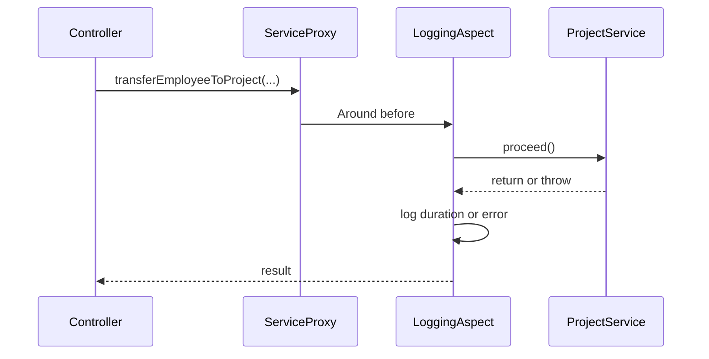

# Learn AOP by adding service logging to EMS

## Why AOP appears now

You care about what business methods did: transfer, assign, create, list. The naive approach is:

```java
log.info("transfer started...");
// business code
log.info("transfer finished...");
```

copied into every method in `EmployeeService`, `ProjectService`, `DepartmentService`. That is a **cross-cutting concern**: the same “log around work” rule repeats everywhere and is easy to forget on new methods (like `transferEmployeeToProject`).

Today EMS only logs in `GlobalExceptionHandler` (unexpected 500s). There is **no** AOP dependency and **no** systematic method logging.

**AOP** lets you write that rule **once**. Spring applies it around matching methods via a **proxy** — the same idea as `@Transactional`.



---

## What you will build

One aspect that wraps **all public methods** under `employee_management_system.service`:

| Event | Level | Content |
|---|---|---|
| Method starts | INFO | class, method, arguments |
| Method succeeds | INFO | class, method, duration ms |
| Method throws | ERROR | class, method, duration ms, exception message |

- No edits inside existing service method bodies.
- Controllers stay free of logging boilerplate.
- Re-throw exceptions so `@Transactional` rollback and `GlobalExceptionHandler` still work.

---

## Step 1 — Add the AOP starter

In `pom.xml`:

```xml
<dependency>
  <groupId>org.springframework.boot</groupId>
  <artifactId>spring-boot-starter-aop</artifactId>
</dependency>
```

Without this, `@Aspect` classes are ignored.

---

## Step 2 — Create `ServiceLoggingAspect`

New file:

`src/main/java/employee_management_system/aspect/ServiceLoggingAspect.java`

Shape:

```java
@Aspect
@Component
public class ServiceLoggingAspect {
  private static final Logger log = LoggerFactory.getLogger(ServiceLoggingAspect.class);

  @Around("execution(* employee_management_system.service..*(..))")
  public Object logServiceCall(ProceedingJoinPoint joinPoint) throws Throwable {
    // 1) log entry + args
    // 2) start = currentTimeMillis
    // 3) try { result = joinPoint.proceed(); log success + duration; return result; }
    // 4) catch { log error + duration; throw; }  // must rethrow
  }
}
```

Terms to learn while writing it:

| Term | Meaning |
|---|---|
| **Aspect** | The class that holds the cross-cutting rule (`@Aspect`) |
| **Join point** | A place advice can run (here: a method call) |
| **Pointcut** | Which join points — `execution(* …service..*(..))` |
| **Advice** | What to do — `@Around` before/after `proceed()` |
| **`proceed()`** | Run the real service method; omit it and business code never runs |

---

## Step 3 — Keep scope tight (learning defaults)

- Target **service** only (not controllers, not repositories).
- Log args with `Arrays.toString(joinPoint.getArgs())` — fine for EMS ids/DTOs; do not later log passwords the same way.
- Do not change return values or swallow exceptions in the aspect.
- Do not put business rules or `@Transactional` in the aspect.

---

## Step 4 — Verify

Restart the app after adding the starter.

1. `GET /api/projects/list` → INFO entry + success with duration for `ProjectService.getAllProjects`.
2. `POST /api/projects/15/employees/17/transfer/9999` → INFO entry, then ERROR for `transferEmployeeToProject`, API still **404**.
3. Confirm `ProjectService` itself has **no** new `log.info` lines — the aspect supplies them.

Optional (only if logs are noisy):

```properties
logging.level.employee_management_system.aspect=INFO
```

---

## How this connects to what you already know

- `@Transactional` is also AOP: a proxy wraps the method and commits or rolls back.
- Your logging aspect is another proxy layer around the same services.
- Self-invocation (`this.otherMethod()`) bypasses the proxy — same caveat as transactions.

---

## Out of scope (defer)

- Controller/repository logging
- Only `@Before` / `@AfterReturning` (Around is enough for this lesson)
- Custom `@Loggable` annotation
- MDC request ids / JSON logs
- Notion notes unless asked separately

---

## Implementation checklist

1. Add `spring-boot-starter-aop` to `pom.xml`
2. Create `ServiceLoggingAspect` with `@Around` on `employee_management_system.service..*`
3. Hit list + failing transfer; confirm INFO/ERROR logs and unchanged HTTP behavior

---

## Reflection

If you validated the target project *before* delete, you would still want `@Transactional` for other mid-method failures. Same idea here: even if you paste logs carefully today, AOP keeps the rule in one place when the next service method appears.

Should the aspect log **every** service method, or only write methods (create/transfer/delete) first — and why might “every method” be better for learning pointcuts?
